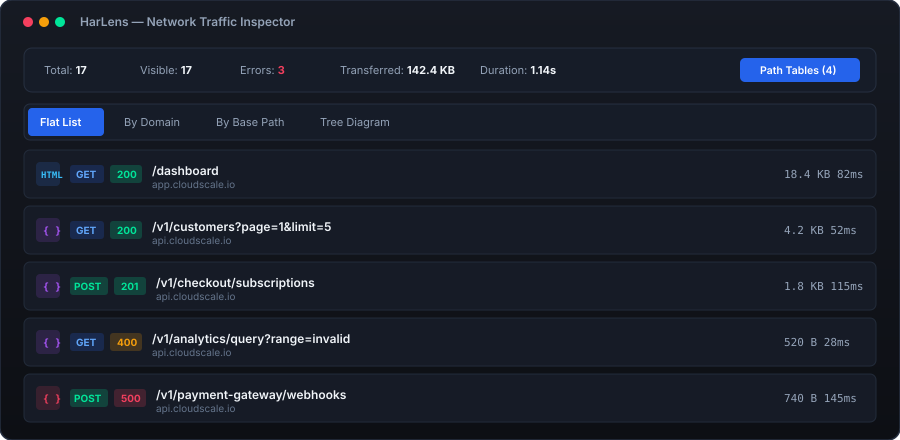
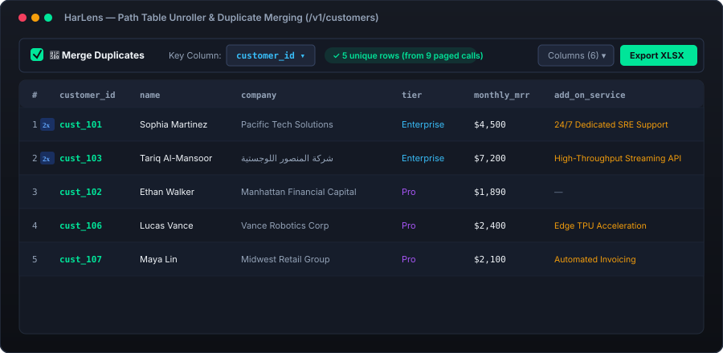
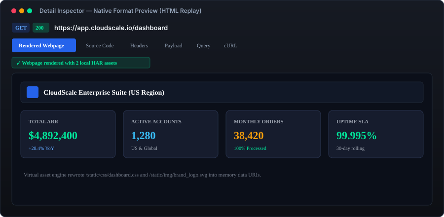
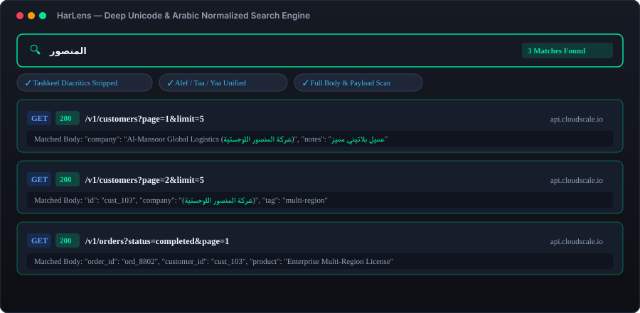
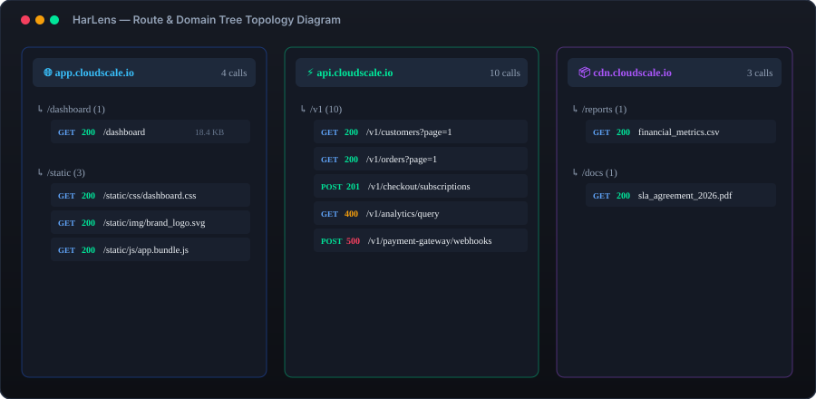

# HarLens

> **An advanced, offline-first HTTP Archive (HAR) analyzer and multi-session traffic inspector designed for high-performance network debugging.**  
> Analyzing complex HTTP archive files across multiple sessions and microservices often leads to browser memory bloat, unreadable payloads, and fragmented workflows; **HarLens** solves this by providing a unified, client-side engine that ingests, normalizes, and cross-correlates multi-archive network logs with native format previews, Arabic/Unicode deep search, JSON table unrolling, and native Excel XLSX export.

[](https://harlens.vercel.app/)
[](LICENSE)

---

## 🚀 Live Access

**No download, installation, or configuration required.**  
Access the web tool directly from any browser or mobile device:

### 👉 **[https://harlens.vercel.app/](https://harlens.vercel.app/)**

Simply drag & drop your `.har` file(s) into the browser window to start analyzing immediately. All processing runs 100% locally on your machine—no data is uploaded to any server.

---

## 📸 Visual Walkthrough & Core Capabilities

### 1. Multi-Archive Traffic & Status Overview
Inspect multi-session archives with real-time transfer metrics, HTTP status code badges (`2xx`, `3xx`, `4xx`, `5xx`), method tags, and granular asset category pills (`JSON`, `HTML`, `JS`, `CSS`, `Images`, `PDF`, `Sheets`).


---

### 2. Interactive JSON Table Unroller & Duplicate Merging
Automatically unroll nested JSON arrays and sequential paged API calls into clean interactive spreadsheets. Collapse redundant records sharing common keys (e.g., `customer_id`, `id`, `uuid`) into aggregated rows with duplicate badges (`2x`), live column toggling, drag-resizing, and instant **Excel XLSX export**.


---

### 3. Native Format Previews & Sandboxed Webpage Replay
Replay captured HTML web pages directly inside an isolated sandbox with automated virtual asset rewriting that resolves CSS, JS, and image assets from within the HAR archive. Includes native format inspectors for spreadsheets, SVGs, and PDF documents.


---

### 4. Deep Unicode & Arabic Normalized Search
Perform instant multi-token search across URLs, request/response headers, query parameters, and payload bodies. Fully handles Arabic diacritic stripping (Tashkeel) and Alef/Taa/Yaa unification for resilient global text matching.


---

### 5. Hierarchical Route & Domain Tree Topology
Gain immediate structural visibility over multi-domain microservice architectures, API route hierarchies, and error distributions in an interactive tree topology canvas.


---

## Core Features Summary

- **Multi-Archive Ingestion & Merging**: Load multiple `.har`, `.json`, or raw HTTP logs concurrently. Toggle between individual archives or analyze a unified cross-archive timeline.
- **Deep Unicode & Arabic Normalized Search**: Multi-token search with diacritic stripping and full-corpus indexing across URLs, headers, queries, and bodies.
- **Native Format-First Inspector**: In-app rendering for sandboxed HTML replay, base64 images, interactive PDFs, CSV sheets, and syntax-highlighted JSON with one-click value copying.
- **JSON Table Unroller with Smart Duplicate Merging**: Flatten JSON records into interactive tables with automatic candidate key detection.
- **Zero-Dependency XLSX & CSV Export**: Export analyzed tables directly into native Microsoft Excel (`.xlsx` SpreadsheetML) or UTF-8 CSV entirely client-side.
- **Hierarchical Tree Diagram**: Visual domain-and-route diagram providing instant architectural visibility of endpoint topologies.
- **Strict Client-Side Privacy**: Runs 100% locally in modern browsers. Zero telemetry, zero external network requests, zero data collection.

---

## Tech Stack & Architecture

- **Runtime & Engine**: Vanilla ECMAScript 2022+ (Zero external runtime dependencies).
- **Interface & Design**: Semantic HTML5 and modern CSS3 utilizing CSS Custom Properties, flexbox/grid layout, and adaptive Dark/Light theme switching.
- **Data Export Pipeline**: Native SpreadsheetML XML generation for compliant, high-performance Microsoft Excel files.
- **Sandboxing & Security**: Isolated iframe rendering with strict script boundary sandboxing to prevent cross-origin contamination from captured responses.
- **Deployment Platform**: Optimized for Vercel static edge hosting with HTTP security headers and aggressive asset caching.

```
HarLens/
├── assets/
│   ├── icon.svg                      # Vector application icon
│   └── screenshots/                  # Visual walkthrough illustrations
│       ├── 01-traffic-overview.svg
│       ├── 02-json-table-unroller.svg
│       ├── 03-format-preview.svg
│       ├── 04-unicode-arabic-search.svg
│       └── 05-tree-diagram.svg
├── css/
│   └── style.css                     # Production stylesheet & dark/light palettes
├── js/
│   └── app.js                        # Core parsing, table unrolling & export engine
├── .env.example                      # Environment variables template
├── .gitignore                        # Production ignore rules
├── index.html                        # Semantic HTML5 entry point
├── LICENSE                           # MIT License
├── package.json                      # Project manifest and dev server scripts
├── README.md                         # Executive documentation & visual walkthrough
├── robots.txt                        # Search engine crawler directives
├── sitemap.xml                       # Search engine sitemap
├── tool.json                         # Native application descriptor
└── vercel.json                       # Vercel deployment & security headers configuration
```

---

## Usage Guide

### 1. Ingesting HAR Archives
- Drag and drop one or more `.har` files into the universal dropzone or click to select files.
- When loading multiple files, the **Imported Archives** bar allows switching between individual files or viewing all requests combined.

### 2. Deep Search & Filtering
- Use `Ctrl + K` or `/` to focus the deep search input.
- Type search terms (including Arabic text or Unicode characters); the engine normalizes variants and searches URLs, headers, payloads, and response bodies simultaneously.
- Filter by HTTP Method (`GET`, `POST`, `PUT`, `DELETE`), HTTP Status (`2xx`, `3xx`, `4xx`, `5xx`, `ERR`), or Asset Category (`JSON`, `HTML`, `JS`, `CSS`, `Images`, `PDF`, `Sheets`).

### 3. Native Previews & Inspection
- Click on any request row to open the **Detail Inspector Modal**.
- Navigate between tabs:
  - **Format Preview**: Automatically renders webpages, images, PDFs, media, or copy-ready JSON.
  - **Source Code**: Full raw text viewer with case-insensitive search and line matching.
  - **Headers & Query**: Structured tables displaying all request/response metadata.
  - **cURL**: Generate clean, ready-to-paste cURL CLI commands.
  - **Table / Records**: Unroll JSON responses into spreadsheet tables.

### 4. JSON Table Unrolling & Excel Export
- From the detail modal or the **Path Tables** combiner modal, select endpoints to unroll.
- Toggle **Merge Duplicates** to collapse repeated items sharing a common key.
- Toggle columns on/off using the **Columns** dropdown.
- Click **Export XLSX** to generate a native `.xlsx` spreadsheet on the fly.

---

## Author

**Faysal Alibrahim**  
GitHub: [https://github.com/FAYSAL-Q8](https://github.com/FAYSAL-Q8)

---

## License

This project is open-source software licensed under the [MIT License](LICENSE).
